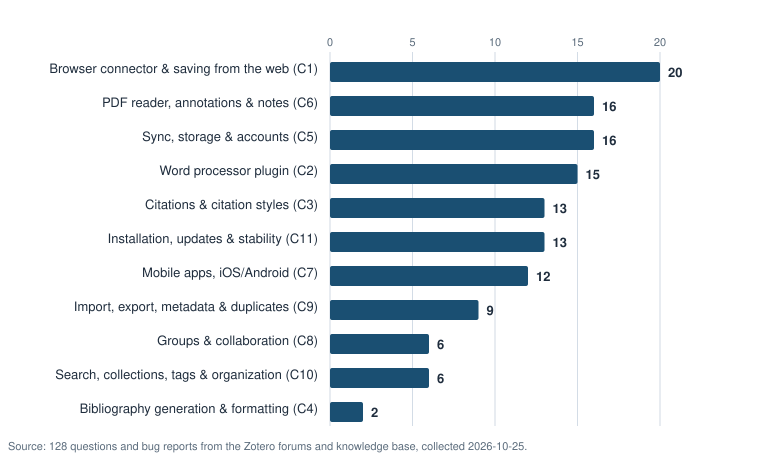

# Research Tools Academy

An unofficial customer education academy for Zotero (the free, open-source reference manager), aimed at graduate students. Built from an analysis of **145 real public support questions**, with three learning paths, a data-driven troubleshooting tool, a skills check, and an adoption metrics plan.

**[Live site](https://iwyusdaz.github.io/research-tools-academy/)** · **[Support analysis](analysis/support-analysis.md)** · **[Evaluation methods](evaluation/METHODS.md)** · Role: Sole designer

**Evaluation status:** Automated accessibility testing and agent-based design reviews are complete. AI-simulated learner and review-panel evaluations are pending. No real learners have tested this yet. See [evaluation/METHODS.md](evaluation/METHODS.md).

---

## The problem

Graduate students lose their first weeks to a reference manager — and the support data shows exactly where they get stuck. I analyzed **145 real, public support questions** (131 Zotero forum threads + 14 official knowledge-base topics, collected 2026-10-25, paraphrased, no usernames):

**The headline finding: five categories hold 62% of all questions — and 40% of everything people ask for help with is education-fixable (a knowledge gap or an avoidable documented behavior).**

| Category | Questions + bugs | Share |
|---|---:|---:|
| Browser connector & saving from the web | 20 | 15.6% |
| PDF reader, annotations & notes | 16 | 12.5% |
| Sync, storage & accounts | 16 | 12.5% |
| Word processor plugin | 15 | 11.7% |
| Citations & citation styles | 13 | 10.2% |
| *(…6 more categories)* | *48* | *37.5%* |

Splitting each question by *fix route* — the customer-education version of "is it training?" — 40% were education-fixable (31% pure knowledge gaps + 9% documented-but-avoidable behavior, 51 of 128 questions), and 60% were product or bug issues that education honestly cannot fix (77 questions routed to diagnosis-and-forum, not fake fixes). Citations & citation styles was the most education-fixable category of all — 12 of its 13 questions (7 knowledge gaps + 5 documented-but-avoidable behaviors).

## Audience and context

You act as customer education lead for a research-tools organization; the goal is that new graduate students become productive with Zotero in their first week. Personas: **Mei** (24, first literature review), **Tom** (31, thesis with 400+ sources), **Ana** (45, part-time degree, Word on a locked-down work laptop).

## My approach

Analysis → design → build → evaluate, with the milestone model in the middle:

1. **Support analysis** (above) → 11 categories × lifecycle stage × fix route; top-5 issues feed the troubleshooting tool, top knowledge gaps feed the lessons ([method](analysis/support-analysis.md#1-method), [limitations](analysis/support-analysis.md#4-limitations)).
2. **Journey map + activation milestones.** Eight stages from discover to maintain, mapped to milestones **M1** first capture → **M2** working collection → **M3** first citation (the headline activation event) → **M4** correct bibliography → **M5** sync, plus extended E1–E2 ([journey map](analysis/journey-map.md), [milestones](analysis/activation-milestones.md)).
3. **Build:** 3 paths / 11 lessons (each ≤ 7 minutes, each mapped to a milestone), a troubleshooting tool data-driven from `flows.json` for the top 5 issues, a 9-scenario skills check, 2 job aids, and the strategy layer ([metrics](docs/strategy/metrics-plan.md) · [simulated dashboard](docs/strategy/dashboard-simulated.md) · [maintenance](docs/strategy/maintenance-plan.md) · [launch](docs/strategy/launch-plan.md)).
4. **Evaluate** (status at top; details in [evaluation/METHODS.md](evaluation/METHODS.md)).

Every lesson is written from the official Zotero documentation and stamped *"Last verified against Zotero 10.0.6 documentation on 2026-10-25"*, with a link to the official docs. Diagrams are schematic SVG illustrations labeled *"Illustration, not an actual screenshot"* — no fake screenshots. This is an independent learning project: **not affiliated with or endorsed by Zotero or its developers**, with a disclaimer on every page.

## Key design decisions

| Decision | Alternatives considered | Rationale and evidence |
|---|---|---|
| Needs analysis from **real support questions** | Assume needs from feature lists | Grounded and citable; reveals which problems are product issues vs. education-fixable (40% / 60% split). Forum URLs in every row of the dataset |
| **Milestone-driven paths** (M1–M5) | Feature-by-feature tour | Customer education is judged on adoption and time-to-value; every lesson maps to a milestone and lessons that moved none were cut |
| **Short task-based lessons** (≤ 7 min) | A long course | Users learn at the moment of need; the week-1 support data clusters on exactly two skills (connector, Word plugin) |
| **Troubleshooting tool, not FAQ** | FAQ page | Guided one-fix-at-a-time diagnosis for the top-5 issues; each fix step ends in "Did this solve it?"; honest exits to the official forum with Debug ID guidance where a fix isn't in the user's control |
| **Schematic SVGs, no screenshots** | macOS GUI automation to capture real screenshots | GUI automation was out of scope for this build; schematics with numbered callouts are version-stable and fully accessible (alt text, no color-only meaning) |
| **Version stamps + maintenance plan** | Publish and forget | Zotero updates itself; stale steps erode trust. Every lesson is stamped; 5 review triggers; quarterly audit; "Report an outdated lesson" issue template |

## Evidence and evaluation

- **What was measured:** support-question frequencies and fix routes (real, n=145); keyboard-only task completion of both tools (46 scripted checks, all passing); axe-core audits of every page (0 critical/serious); a structured **Agent review** ([full report](evaluation/agent-review.md)), whose 13 findings were triaged and fixed on 2026-10-26 (see [CHANGELOG.md](CHANGELOG.md)).
- **What it can and cannot show:** the analysis shows what people ask for, not true incidence (forum posters are a biased sample — stated in the analysis). The keyboard tests prove the flows work, not that learners succeed. The Agent review shares the underlying model with the author — labeled as such. Simulated-learner runs and the review panel are **pipeline-ready but pending** (`npm run eval:pending`; never faked). No real learners have tested this.
- **What it changed:** the 40% education-fixable finding shaped the two "writing" job aids; the week-1 cluster justified front-loading the Getting started path; the product-issue share shaped the troubleshooting tool's honest forum exits. Evaluation-driven revisions are recorded in [CHANGELOG.md](CHANGELOG.md).

## Accessibility

- One `h1` per page, logical heading order, `lang` on `<html>`, alt text that describes the relevant state (never "screenshot"), disclaimers and version stamps in text.
- Both interactive tools: every step is a heading that receives focus; options are buttons/radios; Back / Start over; keyboard-only task completion verified by script; no positive `tabindex`; 320 px reflow checked.
- Callouts in diagrams are **number + outline**, never color alone.
- Tested with axe-core (0 critical/serious) and Playwright keyboard tests. **Not yet tested with a screen reader** — Guidepup/VoiceOver automation is unavailable on the build machine, so a [manual VoiceOver protocol](evaluation/human-protocol/voiceover-manual-check.md) is provided instead; the absence of review by a screen reader user is a stated limitation.

## What I'd do differently / next steps

1. **Run the pending evaluations** (API keys → `npm run eval:pending`), then the usability test with 3–5 grad students using the [prepared protocol](evaluation/human-protocol/usability-test-script.md).
2. **Verify lessons in the real app** and replace schematics with annotated screenshots where they help (the shot lists are implicit in each lesson's steps).
3. **Deflection readout needs a deployment** — the metrics plan is designed for a staggered pilot with a university library ([launch plan](docs/strategy/launch-plan.md)).

## Tools used

Jekyll + Just the Docs (v0.12.0, pinned) on GitHub Pages · vanilla HTML/CSS/JS for the two tools · Playwright 1.57 (keyboard tests, screenshots) · axe-core 4.11.1 · hand-written SVG chart/schematic generators (committed, reproducible) · gitleaks · Chrome headless (job aid PDFs) · Claude (ZCode) for AI-assisted drafting, with all steps verified against the official Zotero documentation.

## License and attribution

- Learning content (lessons, analysis, job aids): [CC BY 4.0](LICENSE)
- Code (HTML/JS/CSS/build scripts): [MIT](LICENSE-CODE)
- Third-party material and data sources: [ATTRIBUTION.md](ATTRIBUTION.md)
- Zotero is a trademark of its owners; this academy is unofficial. Contact: [Email] · [LinkedIn]
