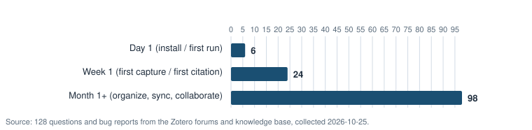

# Support Question Analysis: What Zotero Users Ask For Help With

*Analysis date: 2026-10-25. Data set: [`support-questions.csv`](support-questions.csv) (145 rows). Charts regenerate with `node analysis/generate-charts.mjs` (source: [`generate-charts.mjs`](generate-charts.mjs)).*

This analysis is the foundation of the academy. It answers three questions:

1. **What do Zotero users ask for help with?** (frequency by category)
2. **Which of those problems can education fix, and which are product issues?** (the customer-education version of "is it training?")
3. **When in a user's first months do these problems happen?** (lifecycle stage → activation milestones)

**Headline findings**

- **51 of 128 questions (40%) were knowledge or workflow gaps that education can address.** The other 77 (60%) were product bugs, crashes, or side effects of documented limitations — education cannot fix those, and pretending otherwise erodes trust.
- **Citations & citation styles is the most education-fixable category:** 12 of its 13 non-feature questions (92%) were knowledge gaps.
- **The largest category overall — the browser connector (20 questions) — splits both ways:** genuine product pain (PDFs not attaching, items not appearing) sits next to pure setup gaps (save button missing, "Zotero is unavailable" because the desktop app is closed).
- **Only 6 of 128 questions (5%) were day-1 problems.** Forum posters overwhelmingly hit trouble in month 1+, which is itself a finding: the people loud enough to post are established users, so a new-user academy cannot be designed from forum volume alone (see [Limitations](#limitations)).

---

## 1. Method

### 1.1 Sources

| Source | What was collected | Rows |
|---|---|---|
| [Zotero Forums](https://forums.zotero.org/) (public) | Recent and high-traffic support threads across the forum's topic areas (saving, word processor plugins, sync, storage, PDF reader, groups, mobile) | 131 |
| [Zotero official knowledge base](https://www.zotero.org/support/kb/) | Topics that answer recurring questions; each KB topic was recorded as evidence that the underlying question recurs often enough to earn an official page | 14 |
| **Total** | | **145** |

Threads were browsed on **2026-10-25** (recorded per row in `access_date`). A sample of **23 of the 145 URLs (16%) was re-verified** on 2026-10-25 and all returned HTTP 200.

### 1.2 Privacy and paraphrasing

- Every question is **paraphrased**, never copied. Paraphrases preserve the user's *problem*, not their wording.
- **No usernames, display names, or personal details were collected.** Only the public thread URL is recorded.
- Thread URLs are to public content; users who post in public support forums expect the content to be public.

### 1.3 Coding scheme

Each row was coded on four dimensions:

| Field | Values | Purpose |
|---|---|---|
| `entry_type` | `question` (57), `bug` (71), `feature` (17) | Feature requests are logged but **excluded from the knowledge-gap analysis** (128 questions + bugs remain) |
| `category_code` / `category` | 11 categories (table below) | Frequency analysis |
| `lifecycle_stage` | `day-1`, `week-1`, `month-1-plus` | Journey mapping and milestone design |
| `fix_route` | `education` = a knowledge or workflow gap the academy can fix; `product` = bug, crash, or a limitation of the product as shipped; `both` = documented behavior that education can help users avoid (e.g., "don't edit citations as text in Word") | The "is it training?" test |

### 1.4 Categories

| Code | Category | Definition (what belongs here) |
|---|---|---|
| C1 | Browser connector & saving from the web | Connector install/enabling, save button, translators, PDFs not attaching on save |
| C2 | Word processor plugin (Word/LibreOffice/Google Docs) | Plugin install and visibility, communication errors, citation insertion in documents |
| C3 | Citations & citation styles | Style selection/behavior, in-text formatting questions, style edits |
| C4 | Bibliography generation & formatting | Bibliography creation, ordering, and formatting output |
| C5 | Sync, storage & accounts | Sync errors, storage quota, WebDAV, account/login |
| C6 | PDF reader, annotations & notes | Built-in reader, highlights, annotation extraction, note editor |
| C7 | Mobile apps (iOS/Android) | iOS/Android app behavior and sync with mobile |
| C8 | Groups & collaboration | Group libraries, member management, shared annotations |
| C9 | Import, export & metadata (incl. duplicates) | Migrating between tools, import/export, metadata retrieval, finding/merging duplicates |
| C10 | Search, collections, tags & organization | Searching, collection/tag workflows, sorting |
| C11 | Installation, updates & app stability | Install/startup failures, crashes, update problems |

Coding was done by one person (the author) in one pass. No second coder was used, so no inter-rater reliability figure can be reported — a stated limitation.

---

## 2. Findings

### 2.1 Frequency by category

| Category | Questions + bugs (n=128) | Share |
|---|---:|---:|
| C1 Browser connector & saving from the web | 20 | 15.6% |
| C6 PDF reader, annotations & notes | 16 | 12.5% |
| C5 Sync, storage & accounts | 16 | 12.5% |
| C2 Word processor plugin | 15 | 11.7% |
| C3 Citations & citation styles | 13 | 10.2% |
| C11 Installation, updates & stability | 13 | 10.2% |
| C7 Mobile apps (iOS/Android) | 12 | 9.4% |
| C9 Import, export, metadata & duplicates | 9 | 7.0% |
| C8 Groups & collaboration | 6 | 4.7% |
| C10 Search, collections, tags & organization | 6 | 4.7% |
| C4 Bibliography generation & formatting | 2 | 1.6% |

**Takeaway:** the top five categories (C1, C6, C5, C2, C3) account for **62% of all questions (80 of 128)** — all five are touched by the academy's troubleshooting tool or lessons.

### 2.2 The "is it training?" test: education vs product

| Route | Questions + bugs (n=128) | Share | What the academy does about it |
|---|---:|---:|---|
| Education (knowledge gap) | 40 | 31% | Lessons, job aids, skills check |
| Both (documented behavior, avoidable) | 11 | 9% | Lessons teach the workaround; troubleshooting flow mentions the limit honestly |
| Product / bug | 77 | 60% | Troubleshooting tool helps users diagnose and self-serve known fixes; otherwise routes to the official forum with the right artifacts (Report ID, Debug ID) |
| *(feature requests, excluded)* | *17* | — | *Route to the product team in a real org; not education work* |

**Takeaway:** a naive reading of "60% is product issues — not my job" would be wrong in an interesting way. Of the 77 product-routed questions, many are *diagnosable* by users themselves (quota full, sync error icon, connector blocked by another extension). The troubleshooting tool exists precisely to turn those "product" questions into self-service — while being honest that some (crashes, translator regressions) need the product team or the forums.

### 2.3 When in the lifecycle do problems happen?

| Stage | Questions + bugs (n=128) | Share |
|---|---:|---:|
| Day 1 (install / first run) | 6 | 4.7% |
| Week 1 (first capture / first citation) | 24 | 18.8% |
| Month 1+ (organize, sync, collaborate) | 98 | 76.6% |

**Takeaway:** week-1 questions cluster around the connector and the Word plugin — exactly the two on-ramps the activation milestones M1–M3 measure. That concentration justifies front-loading the Getting started and Writing with citations paths. Month-1+ volume (sync, annotations, groups) justifies the Power user path and the maintenance plan, but it also reflects the forum's population bias (see Limitations).

### 2.4 Top 5 issues → the troubleshooting tool

The troubleshooting tool ([docs/troubleshoot/](../docs/troubleshoot/)) covers these five flows, chosen for frequency **and** for whether guided diagnosis genuinely helps:

| # | Flow | Data basis | Example rows |
|---|---|---|---|
| 1 | The Zotero save button doesn't appear in my browser | C1; official KB topic earns a dedicated page ([#134](https://www.zotero.org/support/kb/no_toolbar_button)) | [#73 Safari connector missing](https://forums.zotero.org/discussion/133445/) |
| 2 | Saving fails: "Zotero is unavailable", or items/PDFs never appear | C1; 20-question category, two distinct failure modes ([#135](https://www.zotero.org/support/kb/connector_zotero_unavailable)) | [#86 saves but items don't appear](https://forums.zotero.org/discussion/133695/), [#91 JSTOR PDF not attached](https://forums.zotero.org/discussion/133925/) |
| 3 | The Zotero tab is missing in Microsoft Word | C2; classic first-citation blocker | [#46 error updating document](https://forums.zotero.org/discussion/132613/), [#138 macOS permissions](https://www.zotero.org/support/kb/mac_word_permissions_missing) |
| 4 | Citations show as `ADDIN ZOTERO_ITEM` codes, or won't update | C2/C3; pure knowledge gap ([#139](https://www.zotero.org/support/kb/word_field_codes), [#140](https://www.zotero.org/support/kb/citations_not_updating)) | [#58 bibliography editing fails](https://forums.zotero.org/discussion/133054/) |
| 5 | PDFs or changes won't sync across devices | C5; 16-question category with known self-service fixes ([#132](https://www.zotero.org/support/kb/files_not_syncing), [#133](https://www.zotero.org/support/kb/changes_not_syncing)) | [#99 HTTP 429 on sync](https://forums.zotero.org/discussion/134061/), [#143 repeated conflicts](https://www.zotero.org/support/kb/repeated_conflicts) |

### 2.5 Top knowledge gaps → lessons

The largest education-fixable clusters map directly to the learning paths:

| Knowledge gap (fix_route = education or both) | n | Lesson(s) that address it |
|---|---:|---|
| Citation style behavior and configuration (C3) | 12 | [Choose a citation style and insert citations](../docs/paths/writing-with-citations/insert-citations.html), [Fix common citation formatting errors](../docs/paths/writing-with-citations/fix-formatting-errors.html) |
| Sync setup and "files not syncing" (C5) | 7 | [Sync your library across devices](../docs/paths/power-user/sync-across-devices.html) + troubleshooting flow 5 |
| Connector setup: no save button, "Zotero is unavailable", Safari quirks (C1) | 7 | [Install Zotero and the browser connector](../docs/paths/getting-started/install-zotero.html) + flows 1–2 |
| Moving libraries, importing, finding duplicates (C9) | 7 | [Save your first sources](../docs/paths/getting-started/save-first-sources.html), [Organize with collections and tags](../docs/paths/getting-started/collections-and-tags.html) (dedupe step) |
| Word plugin visibility and macOS permissions (C2) | 5 | [Install the word processor plugin](../docs/paths/writing-with-citations/install-word-plugin.html) + flow 3 |
| Group library membership and sharing norms (C8) | 4 | [Group libraries for research teams](../docs/paths/power-user/group-libraries.html) |

(Counts: education + both rows per cluster; a row can anchor more than one lesson.)

---

## 3. How this shaped the academy

1. **The paths follow the pain.** Getting started and Writing with citations exist because week-1 questions cluster on the connector and the Word plugin — not because a feature list says so.
2. **The troubleshooting tool is data-driven.** Five flows, each traceable to CSV rows and official KB pages; each flow's steps come from the official documentation, not guesses.
3. **Product issues get honest routing.** Flows end in "post to the Zotero forums with a Report ID" where a fix genuinely isn't in the user's control. Deflecting those with fake "fixes" would betray the user.
4. **Feature requests are out of scope.** 17 rows are logged for a (real) product team; education cannot grant features.

## 4. Limitations

- **Forum posters are a biased sample.** They have problems, are motivated enough to post, skew toward advanced usage (76.6% of questions came from month-1+ users), and skew English-speaking. The silent majority — including users who never got Zotero working at all — is underrepresented. Day-1 volume (6 questions) almost certainly understates day-1 difficulty.
- **Volume is not incidence.** A category's thread count reflects how many people post, not how many hit the problem.
- **One coder, one pass.** Category and fix-route assignments were not double-coded; borderline judgments (e.g., education vs. both) are the author's alone.
- **Paraphrasing** can shift nuance; original threads are linked so readers can check.
- **A snapshot, not a panel.** Threads were collected on one date (2026-10-25) and represent the forum's recent/high-traffic mix, not a census of a defined period.

## 5. Data dictionary

See the header row and inline notes of [`support-questions.csv`](support-questions.csv). Row notes mark threads that were official KB topics (`official knowledge-base topic`), identified as the forum's most-visible recurring threads at collection time (`top issue`), or accompanied by a crash/debug dump (`crash dump`, `debug dump`, `error dump`).
